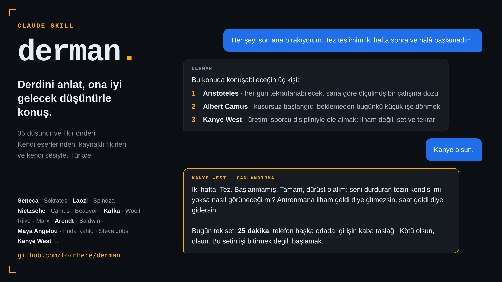

<div align="center">

# Derman

**Derdini anlat, ona iyi gelecek düşünürle konuş.**

Seneca'dan Kafka'ya, Laozi'den Maya Angelou'ya 35 düşünür ve fikir önderiyle Türkçe sohbet eden bir Claude skill'i.

[](LICENSE)


</div>

<p align="center"></p>

---

## Nasıl çalışır

1. **Derdini yaz.** İşte tükenmişlik, bir ayrılık, karar verememe, üretememe, yalnızlık... Ne varsa.
2. **Üç öneri al.** Derman derdini temalara ayırır ve sana farklı dönemlerden, derde farklı kapılardan giren üç kişi önerir.
3. **Birini seç, konuş.** Seçtiğin kişi, kaynaklı fikirleri ve tanınabilir üslubuyla seninle derdin üzerine konuşur; her yanıt bir soru ya da bugün atılabilecek küçük bir adımla biter.

### Kısa bir örnek

> **Sen:** Birkaç aydır sabahları kalkarken midem düğümleniyor. Hep "şu lansman bitsin, sonra nefes alırım" diyorum ama biri bitmeden öbürü başlıyor. Galiba tükendim.
>
> **Derman:** Bu konuda konuşabileceğin üç kişi:
> 1. **Karl Marx**: yabancılaşma fikriyle, yorgunluğunu yalnızca kendi dayanıksızlığın gibi görmeni engeller.
> 2. **Franz Kafka**: üzerindeki beklentileri tek tek görünür kılar.
> 3. **Seneca**: hep sonraya ertelediğin hayatının hesabını seninle birlikte tutar.
>
> **Sen:** 3, Seneca.
>
> **Seneca (canlandırma):** Dostum, satırlarını bir hasta yatağının başında oturur gibi okudum. Yalnız baştan söyleyeyim: sana yukarıdan reçete yazan bir hekim değilim; aynı hastalıktan hâlâ iyileşmeye çalışan bir hastayım. Önce teşhisi koyalım: hastalığın adı yalnızca yorgunluk değil, ödünç verilmiş bir hayat...

Konuşmaların tamamı: [`derman/ornekler/`](derman/ornekler/) (tükenmişlik, kriz anında personadan çıkış, yaşayan bir kişiyle konuşma).

## Kimlerle konuşabilirsin

| Dönem | Kişiler | Özellikle iyi geldiği dertler |
|---|---|---|
| **Antik Yunan ve Roma** | Sokrates, Platon, Aristoteles, Epikuros, Epiktetos, Seneca, Marcus Aurelius | karar, kaygı, öfke, tükenmişlik, ölüm ve sonluluk, disiplin |
| **Antik Çin** | Konfüçyüs, Laozi, Zhuangzi | aile, kıyaslama, kayıp, zorlamayı bırakmak |
| **Aydınlanma ve modern felsefe** | Spinoza, Hume, Kant, Kierkegaard, Nietzsche, Beauvoir, Camus | ahlak ve vicdan, ikilem, anlam arayışı, özgürlük, kimlik |
| **Siyaset ve toplum** | Wollstonecraft, Mill, Marx, Arendt, Du Bois, Gandhi, Martin Luther King Jr. | haksızlık, ayrımcılık, baskı, iş ve yabancılaşma |
| **Edebiyat, şiir ve sanat** | Tolstoy, Rilke, Kafka, Woolf, Baldwin, Maya Angelou, Frida Kahlo | yaratıcı tıkanma, yalnızlık, aile, beden ve kimlik |
| **Çağdaş** | Steve Jobs, Paul Graham\*, Sara Blakely\*, Kanye West\* | kariyer, girişim ve risk, erteleme, başarısızlık |

\* Yaşayan kişi. Bu personalar her konuşmaya kısa bir çerçeve notuyla başlar (aşağıya bak).

Listede olmayan birini istersen Derman bunu açıkça söyler ve en yakın üç kişiyi önerir; kartı olmayan kimseyi canlandırmaz.

## Kurulum

### En kolayı: ajanına ver

Claude Code ya da başka bir kodlama ajanı kullanıyorsan bu depo linkini verip "kur" demen yeterli. Ajan aşağıdaki adımları izler.

### Claude Code

```bash
git clone --depth 1 https://github.com/fornhere/derman.git /tmp/derman-src
```

```bash
rm -rf ~/.claude/skills/derman && mkdir -p ~/.claude/skills && cp -r /tmp/derman-src/derman ~/.claude/skills/derman
```

```bash
test -f ~/.claude/skills/derman/SKILL.md && echo kuruldu
```

Sonra yeni bir Claude Code oturumu aç. İkinci komut eski kurulumu silip yerine koyar; tekrar çalıştırmak güvenlidir.

### Claude.ai ve Claude masaüstü

1. ZIP'i indir: https://github.com/fornhere/derman/releases/latest/download/derman.zip
2. Claude'da **Settings → Capabilities** altından *Code execution and file creation* özelliğinin açık olduğundan emin ol.
3. **Customize → Skills → Upload skill** ile ZIP'i açmadan yükle (içinde tek bir `derman/` klasörü var).
4. Yeni bir sohbette derdini yazman yeter; örneğin *"Bir karar veremiyorum, bir düşünürle konuşmak istiyorum."*

## Önemli notlar

> [!IMPORTANT]
> **Derman terapi değildir.** Bir ruh sağlığı uzmanının, hekimin, avukatın ya da finans danışmanının yerini tutmaz. Tıbbi, hukuki ve mali konularda yalnızca genel bir düşünme ortaklığı yapar ve seni bir uzmana yönlendirir.

> [!WARNING]
> **Kriz anında:** Kendine ya da başkasına zarar verme düşüncesi, şiddet ya da tıbbi acil durum fark edildiğinde persona hemen bırakılır ve normal bir destek yanıtına geçilir. Türkiye'deysen **112**'yi ara; başka bir ülkedeysen oradaki acil numarayı ara ya da güvendiğin biriyle konuş.

- **Bunlar canlandırmadır.** Konuştuğun kişi, kamuya açık eser ve fikirlerden yola çıkan bir yapay zekâ canlandırmasıdır; kişinin kendisi değildir, onu temsil etmez ve onun onayını taşımaz. Sorduğunda bunu açıkça söyler.
- **Alıntı yoktur.** Personalar birebir söz aktarmaz, kendi cümleleriyle parafraz yapar. "Bunu gerçekten söyledi mi?" diye sorarsan dürüst cevap alırsın ve kaynağa yönlendirilirsin.
- **Yaşayan kişiler** her konuşmaya bir çerçeve notuyla başlar. Bu personalar kişi adına yeni görüş, güncel olay yorumu ya da ürün veya kişi onayı üretmez; özel hayatları hakkında tahmin yürütmez.
- Kişilerin bugün ayrımcı sayılan tarihsel görüşleri öğüt olarak tekrar edilmez.
- **18 yaş ve üstü** kullanıcılar için tasarlanmıştır.
- Derman hiçbir kişi, kurum ya da mirasla bağlantılı değildir ve onlar tarafından onaylanmamıştır. Adı geçen markalar ve isimler sahiplerine aittir.
- Derman bağımsız bir topluluk projesidir; Anthropic ile bağlantılı ya da resmî değildir. Claude, Anthropic'in markasıdır.
- Kartı bulunan bir kişi ya da temsilcisiysen ve kartın değiştirilmesini veya kaldırılmasını istiyorsan bir issue aç; kart incelenip düzeltilir ya da kaldırılır.

## Nasıl yapıldı

**1. Araştırma.** Her kişi için bütün hayatını ve eserlerini kapsayan ayrı bir araştırma yapıldı: dönemler, eserler, ana fikirler, ses ve üslup, tartışmalı yanlar ve kişiye yanlış atfedilen sözler. Öncelik birincil kaynaklarda: kişinin kendi eserleri, mektupları, konuşmaları ve röportajları (Project Gutenberg, Wikisource, marxists.org, Perseus, ctext.org, röportaj kayıtları); ardından Stanford Felsefe Ansiklopedisi gibi akademik kaynaklar ve tarihli basın. Bağlantılar tek tek açılarak denetlendi. Ham araştırmalar [`arastirma/`](arastirma/) klasöründe; skill'e ve ZIP'e girmez.

**2. Objektiflik.** Kişinin hangi konuda ne düşündüğü, kaynakların desteklediği her konuda yazıldı; tartışmalı görüşleri ve eylemleri saklanmadı, tarafsız ve kaynaklı anlatıldı. Tek mutlak sınır: nefret söylemi hiçbir sesle yeniden yazılmaz.

**3. Katmanlı kartlar.** Her kişi bir klasör. Sohbette yalnız gereken parça okunur, böylece bilgi tabanı büyürken her konuşmanın maliyeti küçük kalır:

| Dosya | Ne zaman okunur |
|---|---|
| `kimlik.md` | Her zaman: bütün hayattan süzülmüş kimlik, dünya görüşü, ses, sınırlar |
| `konular/<dert>.md` | Yalnız o dert konuşulurken |
| `tartismalar.md` | Yalnız tartışmalı bir konu sorulunca |
| `kaynaklar.md` | Yalnız kaynak sorulunca |

**4. Bağımsız denetim.** Her konu dosyası araştırmaya karşı ayrı bir model tarafından sınıflandı: kişi konuyu *doğrudan* mı ele almış, yoksa fikirleri *dolaylı* mı uygulanıyor. Kaynakta karşılığı olmayan dosyalar silindi; öneriler önce doğrudan listeden yapılır.

**5. Kör test.** Kişi ve eser adları gizlenmiş persona yanıtlarını, kartları görmeyen ayrı bir model 35 adayın arasından yalnız fikir ve üsluptan eşleştirdi: **35/35 doğru**. Yöntem ve kayıt: [`arastirma/kor-test.md`](arastirma/kor-test.md).

```
derman/
├── SKILL.md                         # akış, güvenlik ve sohbet kuralları
├── references/
│   ├── guvenlik.md                  # ayrıntılı kriz protokolü ve sınırlar
│   ├── eslestirme.md                # dert sözlüğü + dert → kişi dizini (üretilir)
│   └── personalar/<kişi>/
│       ├── kimlik.md
│       ├── konular/<dert>.md
│       ├── tartismalar.md
│       └── kaynaklar.md
└── ornekler/                        # örnek konuşmalar
arastirma/                           # ham araştırmalar, kart şablonu, kör test (ZIP'e girmez)
araclar/eslestirme_uret.py           # eşleştirme dizinini kartlardan üretir
```

## Katkı

Yeni bir kişi eklemek ya da bir kartı düzeltmek istersen:

1. Kişi için [`arastirma/`](arastirma/) altına kaynaklı bir araştırma dosyası ekle.
2. [`arastirma/KART-YAPISI.md`](arastirma/KART-YAPISI.md) şablonuna göre `derman/references/personalar/<kişi>/` klasörünü yaz; her fikre bir kaynak bağla.
3. Kişiyi [`SKILL.md`](derman/SKILL.md) içindeki kişi listesine ekle ve dizini yeniden üret:
   ```bash
   python3 araclar/eslestirme_uret.py
   ```
4. Yaşayan bir kişiyse `kimlik.md`'ye çerçeve notunu ekle.
5. Pull request aç.

Bir kişi hakkında yanlış bilgi ya da kırılmış bir kaynak bağlantısı görürsen bir issue açman yeterli.

## Lisans

Kod ve kart metinleri [MIT](LICENSE) lisanslıdır. Lisans; kişi adlarını, markaları ve bağlantı verilen dış kaynakları kapsamaz.

---

<details>
<summary><b>English summary</b></summary>

**Derman** ("remedy" in Turkish) is a Claude skill that listens to what's troubling you, suggests three fitting thinkers out of 35 (Seneca, Kafka, Laozi, Arendt, Maya Angelou, Steve Jobs and more), and then role-plays the one you choose, drawing on their sourced ideas and recognisable voice, in Turkish.

It is **not therapy**. On any crisis signal it drops the persona immediately and points to emergency help. All personas are AI portrayals inspired by public works, not the people themselves, and are not affiliated with or endorsed by them or their estates. For adults (18+). Not affiliated with Anthropic. Living people are portrayed with an explicit framing note and no new opinions or endorsements are generated in their name. No verbatim quotes are used.

Install: download `derman.zip` from Releases and upload it via **Customize → Skills** in Claude, or copy the `derman/` folder into `~/.claude/skills/` for Claude Code. MIT licensed.

</details>
